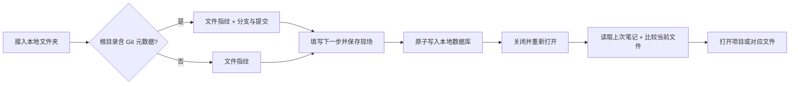

# 续上 · 首版方案与验收

目标：在本地项目中保存“做到哪、为什么、下一步”，关闭应用后能恢复，并看到离开后的文件变化。

## 产品与视觉

- Windows 优先，一键启动本地服务，默认浏览器使用；Node.js 22+，无运行时第三方依赖。
- 明亮白底、冰蓝底色、深蓝文字、亮蓝操作按钮；宽松排版，14–16px 常用文字。
- 工作台：切换项目、最近现场、下一步、离开后的变化。
- 留现场：标题、卡点/决定、下一步、可选文件和行号。
- 工作记忆：按时间浏览、展开现场、查看对应文件摘要。
- 接入与存储：本地文件夹接入、Git 自动识别、JSON 备份与恢复、Markdown 导出。
- 空白安装显示接入入口；独立示例项目必须显式创建，不伪造用户记录。

## 核心流程

## 模块边界

| 模块 | 职责 | 不承担 |
|---|---|---|
| scanner.js | 有界文件扫描、Git 元信息、变化比较 | UI、持久化 |
| store.js | 数据校验、原子写入、备份恢复、串行变更 | 文件扫描、编辑器 |
| service.js | 接入、现场、比较、导入导出等用例 | HTTP 和 DOM |
| server.js | loopback HTTP、请求校验、本地启动、编辑器/目录打开 | 业务存储规则 |
| public/ | 原生 HTML/CSS/JS 视图和交互 | 直接访问文件系统 |

现场是上下文快照，不是源码备份：保存路径、内容指纹和大小，不保存文件正文，不提供源码回滚。
普通文件夹按相同文件指纹比较；Git 项目补充分支、HEAD 和工作区摘要，不依赖远程平台。

## 数据与边界

- 项目：id、名称、规范化绝对路径、接入时间。
- 现场：id、projectId、时间、标题、卡点/决定、下一步、可选相对文件路径/行号、文件清单及 Git 元信息。
- 数据默认存入项目目录 `.xushang-data`，测试与演示使用独立数据目录。
- 原子写入 JSON，保留上次有效备份；限制单进程持有数据目录，防止多实例覆盖。
- 跳过符号链接、依赖/构建目录、常见密钥文件；限制文件数和扫描字节数，UI 显示不完整扫描。
- Git 项目尊重 Git 忽略规则；普通文件夹使用内置忽略目录及 `.xushangignore`。
- 服务仅绑定 127.0.0.1；校验 Host/Origin，API 修改要求同源请求头，文件跳转限制在已接入目录。
- 导入校验结构与版本，追加去重；不覆盖已有现场，不自动执行导入路径。

## 实施顺序

1. [x] 基础：方案、目录、启动器、数据模型。
2. [x] 核心：普通目录/Git 扫描、保存现场、重启持久化与比较。
3. [x] 界面：明亮工作台、项目接入、现场表单、时间线。
4. [x] 完整性：编辑器定位、JSON 恢复、Markdown 导出、异常与空状态。
5. [x] 验收：核心行为自动化测试、真实临时 Git/普通目录、端到端与响应式检查。

## 速度要求

- 首屏只读本地记录，不执行或等待 Git。
- 文件变化在后台独立请求；60 秒内切换项目复用结果。
- 自动检查按大小、修改时间复用文件指纹；手动刷新和保存现场强制检查内容。
- 测试用延迟扫描器验证记录读取不被阻塞。

## 必须通过的验收

- 普通文件夹和本地 Git 仓库都能接入；远程地址不参与识别。
- 保存的文字重启后不丢失；新增/修改/删除文件和分支变化能识别。
- 无效/消失路径、权限、超限扫描有可理解反馈。
- 输入文本安全渲染，文件名不进入 shell 命令；路径越界被拒绝。
- JSON 导出导入保留记录，重复导入不复制；无效导入不损坏数据。
- 页面主要操作实际调用本地服务，窄屏无水平溢出。
- 本机未安装 VS Code 时提供可复制路径和明确反馈。

后续范围：AI 总结、云同步、其他版本控制专用历史、原生安装包、后台自动采集。
